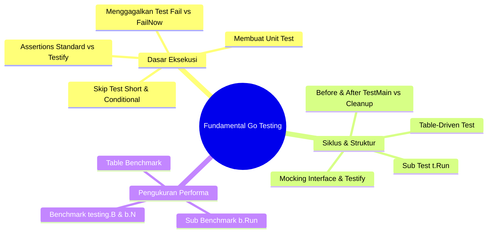

# Rencana Implementasi: Proyek Belajar Unit Test di Golang (Real-World Template)

Dokumen ini berisi rencana komprehensif untuk membangun proyek pembelajaran **Unit Test di Go** yang mengadopsi standar arsitektur dan gaya penulisan riil dari template:
`/home/xylo/Documents/adit/devbox/website-toko-sayur/services/user-service`

---

## 1. Tujuan Proyek (Goals)

1. **Memahami Fundamental Unit Testing & Benchmark di Golang**:
   - Menguasai seluruh fondasi library `testing` standar bawaan Go dan pustaka pelengkap standar industri (`testify`, `go-sqlmock`, `redismock/v9`).
   - Menyediakan contoh nyata untuk 11 konsep pengujian fundamental (lihat Bagian 2).
   - Menghasilkan laporan **Code Coverage** (`go test -coverprofile=...`) dan **Memory Allocation Profiling** (`go test -benchmem`).

2. **Mengikuti Pola Arsitektur Template (`user-service`)**:
   - **Hexagonal / Clean Layered Architecture**: Pemisahan jelas antara `domain/entity`, `domain/model`, `service`, `repository`, `handler`, `middleware`, dan `config`.
   - Inisialisasi aplikasi menggunakan **Cobra CLI** (`cmd/root.go`, `cmd/start.go`).
   - Logging terstruktur dengan **Zerolog**.
   - Konfigurasi environment terpusat dengan **Viper** (`.env`).
   - Validasi request menggunakan **Go Playground Validator v10**.

3. **Skenario Data Riil (PostgreSQL + Redis Cache-Aside & Session)**:
   - Data entitas: **User** (Registrasi, Login/Session, Get Profile dengan Cache, Update Profile dengan Cache Invalidation, Soft/Hard Delete).
   - Pengujian skenario realistis:
     - **Cache Hit**: Data ditemukan di Redis, tidak perlu query ke PostgreSQL.
     - **Cache Miss**: Data tidak ada di Redis, query PostgreSQL, simpan ke Redis (TTL).
     - **Cache Invalidation**: Saat data di-update atau di-delete, cache di Redis dihapus (`DEL`).
     - **Session Auth**: Login menyimpan session di Redis, middleware memverifikasi JWT dan keberadaan session di Redis.

---

## 2. Fundamental Unit Testing di Go (Standar Library `testing`)

Bagian ini merangkum 11 konsep fundamental unit testing dan benchmark di Go yang akan diimplementasikan secara langsung di dalam proyek ini:



### 2.1. Membuat Unit Test
- **Aturan Penamaan Berkas**: Berkas pengujian wajib memiliki akhiran `_test.go` (contoh: `conv_test.go`, `user_service_test.go`). Berkas ini diabaikan saat kompilasi binary aplikasi (`go build`).
- **Aturan Fungsi Test**:
  - Wajib diawali kata `Test` dengan huruf kapital setelahnya (contoh: `TestHashPassword`, bukan `TesthashPassword`).
  - Menerima tepat satu parameter pointer ke struct testing: `t *testing.T`.
- **Package Testing**:
  - *White-box testing* (`package service`): Memiliki akses ke variabel dan fungsi unexported (private) dalam package yang sama.
  - *Black-box testing* (`package service_test`): Hanya menguji API publik (exported), mencegah import cycle dan mensimulasikan penggunaan oleh consumer eksternal.
- **Eksekusi**:
  ```bash
  go test ./...              # Menjalankan seluruh test
  go test -v ./utils/conv/... # Menjalankan dengan log verbose
  go test -run ^TestHash$     # Filter menjalankan fungsi test tertentu
  ```

---

### 2.2. Menggagalkan Test (Failing a Test)
Go tidak menggunakan model `throw/catch exception` dalam pengujian. Pengembang secara eksplisit memilih apakah kegagalan menghentikan eksekusi atau tetap melanjutkan:

| Fungsi | Efek terhadap Status | Kelanjutan Eksekusi Fungsi Test | Kapan Digunakan |
| :--- | :--- | :--- | :--- |
| `t.Fail()` | Ditandai Gagal (`FAIL`) | **Tetap Lanjut** ke baris berikutnya | Saat ingin mencatat kegagalan tanpa pesan khusus. |
| `t.FailNow()` | Ditandai Gagal (`FAIL`) | **Langsung Berhenti** saat itu juga (`runtime.Goexit()`) | Kegagalan fatal di mana langkah berikutnya tidak mungkin valid. |
| `t.Error(args...)` / `t.Errorf(fmt, ...)` | Ditandai Gagal (`FAIL`) + Cetak Log | **Tetap Lanjut** (memanggil `t.Fail()`) | Mengecek banyak field independen (misal verifikasi beberapa kolom JSON). |
| `t.Fatal(args...)` / `t.Fatalf(fmt, ...)` | Ditandai Gagal (`FAIL`) + Cetak Log | **Langsung Berhenti** (memanggil `t.FailNow()`) | Error inisialisasi/setup atau pointer `nil` yang jika dilanjutkan akan `panic`. |

**Contoh Penerapan**:
```go
func TestGetUser(t *testing.T) {
    user, err := service.GetUserByID(ctx, 1)
    if err != nil {
        t.Fatalf("kegagalan fatal: tidak dapat mengambil user: %v", err) // Stop di sini jika error
    }

    // Jika sampai di sini, user dijamin tidak nil sehingga aman diakses
    if user.Name != "Adit" {
        t.Errorf("ekspektasi nama 'Adit', didapat '%s'", user.Name) // Lanjut cek email meskipun nama salah
    }
    if user.Role != "Admin" {
        t.Errorf("ekspektasi role 'Admin', didapat '%s'", user.Role)
    }
}
```

---

### 2.3. Assertions
- **Standard Library Go**: Go sengaja tidak menyediakan fungsi `assert` bawaan demi meminimalkan *magic* dan mendorong pesan kegagalan yang deskriptif:
  ```go
  if got != want {
      t.Errorf("got %v, want %v", got, want)
  }
  ```
- **Pustaka Assertions (`testify`)**: Di proyek nyata, pustaka `github.com/stretchr/testify` menjadi standar industri untuk menjaga kode test tetap ringkas:
  - `assert.Equal(t, want, got)`: Menandai gagal namun tetap melanjutkan test (mirip `t.Errorf`).
  - `require.Equal(t, want, got)`: Menandai gagal dan langsung berhenti (mirip `t.Fatalf`), sangat krusial saat mengecek `require.NoError(t, err)`.

---

### 2.4. Skip Test
Digunakan untuk melewati pengujian yang tidak relevan dengan kondisi lingkungan saat ini:
- `t.Skip(args...)` / `t.Skipf(format, ...)`: Melewatkan test dan mencetak alasan.
- **Penggunaan Flag `-short`**: Memisahkan unit test yang cepat dari test integrasi yang lambat:
  ```go
  func TestHeavyCalculation(t *testing.T) {
      if testing.Short() {
          t.Skip("melewati pengujian lambat pada mode -short")
      }
      // Logika test yang berat dijalankan hanya tanpa flag -short
  }
  ```
  Dijalankan dengan: `go test -short ./...`

---

### 2.5. Before and After Test (Setup & Teardown)
Pengelolaan siklus hidup test untuk membersihkan state / mock:

1. **Tingkat Package (`TestMain`)**:
   Berjalan satu kali sebelum dan sesudah seluruh fungsi test dalam sebuah package dieksekusi:
   ```go
   func TestMain(m *testing.M) {
       // BEFORE: Inisialisasi konfigurasi global atau mock pool
       setupGlobalConfig()

       exitCode := m.Run() // Menjalankan seluruh TestXxx

       // AFTER: Bersihkan sumber daya
       teardownGlobalResources()

       os.Exit(exitCode)
   }
   ```

2. **Tingkat Test Individual (`t.Cleanup`)**:
   Idiom modern Go (sejak Go 1.14) yang lebih aman daripada `defer`, karena dijamin dieksekusi saat test atau subtest selesai bahkan jika dipanggil `t.FailNow()`:
   ```go
   func TestDatabaseOperation(t *testing.T) {
       db := setupTestDB()
       t.Cleanup(func() {
           db.Close() // Terjamin dieksekusi di akhir test
       })
       // Eksekusi pengujian
   }
   ```

---

### 2.6. Sub Test
Membagi satu fungsi test besar menjadi beberapa skenario independen menggunakan `t.Run(name, func(t *testing.T))`:
- **Struktur Hierarki**: Output log menampilkan relasi induk/anak (`TestUserService/ValidUser`, `TestUserService/InvalidEmail`).
- **Pemisahan Scope**: Kegagalan `t.FailNow()` pada satu subtest tidak membatalkan subtest lainnya.
- **Eksekusi Parsial**:
  ```bash
  go test -v -run TestUserService/ValidUser
  ```

---

### 2.7. Table Test (Table-Driven Tests)
Pola paling idiomatik di Golang untuk menguji berbagai variasi input, output, dan kondisi error tanpa menduplikasi boilerplate code:

```go
func TestStringToInt64(t *testing.T) {
    tests := []struct {
        name    string
        input   string
        want    int64
        wantErr bool
    }{
        {name: "angka positif", input: "123", want: 123, wantErr: false},
        {name: "angka nol", input: "0", want: 0, wantErr: false},
        {name: "angka negatif", input: "-45", want: -45, wantErr: false},
        {name: "karakter alfabet (harus error)", input: "abc", want: 0, wantErr: true},
        {name: "string kosong (harus error)", input: "", want: 0, wantErr: true},
    }

    for _, tt := range tests {
        t.Run(tt.name, func(t *testing.T) {
            got, err := StringToInt64(tt.input)
            if (err != nil) != tt.wantErr {
                t.Fatalf("StringToInt64() error = %v, wantErr %v", err, tt.wantErr)
            }
            if got != tt.want {
                t.Errorf("StringToInt64() = %v, want %v", got, tt.want)
            }
        })
    }
}
```

---

### 2.8. Mock (Mocking Objects via Interfaces)
Mekanisme pengujian unit murni yang mengisolasi kode dari dependensi eksternal (Database, Redis, API pihak ketiga).
- Prinsip Desain Go: **Accept interfaces, return structs**.
- Implementasi menggunakan `github.com/stretchr/testify/mock`:
  1. Buat struct mock yang meng-embed `mock.Mock`.
  2. Implementasikan method interface dengan meneruskan argumen ke `m.Called(...)`.
  3. Di dalam test, atur ekspektasi panggilan (`mock.On("Method", arg).Return(val, err)`).
  4. Verifikasi bahwa method benar-benar terpanggil (`mock.AssertExpectations(t)`).

---

### 2.9. Benchmark
Digunakan untuk mengukur kecepatan eksekusi kode (nanodetik per operasi) dan efisiensi memori (alokasi memori):
- **Aturan**:
  - Diawali nama `Benchmark` (contoh: `BenchmarkHashPassword`).
  - Menerima parameter pointer `b *testing.B`.
  - Berisi perulangan sebanyak `b.N` kali. Go secara otomatis menaikkan nilai `b.N` hingga pengujian berjalan stabil.
- **Fungsi Khusus**:
  - `b.ResetTimer()`: Mengabaikan waktu setup yang berat sebelum perulangan benchmark dimulai.
  - `b.ReportAllocs()`: Melaporkan statistik alokasi memori (`B/op` dan `allocs/op`).
- **Eksekusi**:
  ```bash
  go test -bench=. -benchmem ./utils/conv/...
  ```

---

### 2.10. Sub Benchmark
Membagi benchmark menjadi beberapa variasi skenario menggunakan `b.Run(name, func(b *testing.B))`:
```go
func BenchmarkPasswordHashing(b *testing.B) {
    b.Run("cost_4", func(b *testing.B) {
        for i := 0; i < b.N; i++ {
            HashPasswordWithCost("rahasia", 4)
        }
    })
    b.Run("cost_10", func(b *testing.B) {
        for i := 0; i < b.N; i++ {
            HashPasswordWithCost("rahasia", 10)
        }
    })
}
```

---

### 2.11. Table Benchmark
Menggabungkan pola table-driven dengan benchmark untuk mengevaluasi dampak performa terhadap berbagai ukuran dataset atau konfigurasi secara sistematis:
```go
func BenchmarkConvTable(b *testing.B) {
    benchmarks := []struct {
        name  string
        input string
    }{
        {name: "short_number", input: "42"},
        {name: "medium_number", input: "123456789"},
        {name: "max_int64", input: "9223372036854775807"},
    }

    for _, bm := range benchmarks {
        b.Run(bm.name, func(b *testing.B) {
            b.ReportAllocs()
            b.ResetTimer()
            for i := 0; i < b.N; i++ {
                _, _ = StringToInt64(bm.input)
            }
        })
    }
}
```

---

## 3. Struktur Direktori Proyek

Proyek dibangun di direktori `/home/xylo/Documents/adit/devbox/belajar-golang/belajar-golang-unit-test` sesuai struktur template `user-service`:

```text
belajar-golang-unit-test/
├── cmd/
│   ├── root.go                        # Inisialisasi Cobra CLI & Viper config
│   └── start.go                       # Command 'start' untuk bootstrap server
├── config/
│   ├── config.go                      # Struct konfigurasi aplikasi & mapping env
│   ├── database.go                    # Koneksi GORM PostgreSQL & auto-migration
│   ├── fiber.go                       # Konfigurasi Fiber v3 & custom error handler
│   ├── redis.go                       # Inisialisasi client Redis (go-redis v9)
│   └── zerolog.go                     # Logger Zerolog terstruktur
├── database/
│   └── migrations/
│       ├── 000001_create_users_table.up.sql
│       └── 000001_create_users_table.down.sql
├── internal/
│   ├── adapter/
│   │   ├── handler/
│   │   │   ├── request/
│   │   │   │   └── user_request.go    # Struct request payload (JSON tags & validation)
│   │   │   ├── response/
│   │   │   │   ├── default_response.go# Format standar {message, data}
│   │   │   │   └── user_response.go   # DTO response user
│   │   │   ├── user_handler.go        # HTTP endpoints & binding logic
│   │   │   └── user_handler_test.go   # [UNIT TEST] Testing endpoint via Fiber app.Test()
│   │   ├── middleware_adapter.go      # Middleware autentikasi (JWT + Redis session)
│   │   ├── middleware_adapter_test.go # [UNIT TEST] Testing middleware autentikasi
│   │   └── repository/
│   │       ├── user_repository.go     # GORM DB operations & interface
│   │       └── user_repository_test.go# [UNIT TEST] Testing query DB via go-sqlmock
│   ├── app/
│   │   └── app.go                     # Dependency Injection & route wiring & graceful shutdown
│   └── core/
│       ├── domain/
│       │   ├── entity/
│       │   │   ├── jwt_entity.go      # Domain entity untuk token JWT & session
│       │   │   └── user_entity.go     # Domain entity murni untuk user
│       │   └── model/
│       │       └── user_model.go      # GORM model & struct mapping DB table
│       └── service/
│           ├── jwt_service.go         # Implementasi token generation & validation
│           ├── jwt_service_test.go    # [UNIT TEST] Testing JWT service
│           ├── user_service.go        # Business logic (Cache-Aside Redis + Repository)
│           ├── user_service_test.go   # [UNIT TEST] Testing business logic via Mock Repo & Redismock
│           └── mocks/
│               └── user_repository_mock.go # Mock UserRepository via testify/mock
├── utils/
│   ├── conv/
│   │   ├── conv.go                    # Helper hashing bcrypt & konversi tipe
│   │   ├── conv_test.go               # [UNIT TEST & BENCHMARK] Table test & Table benchmark
│   │   └── conv_benchmark_test.go     # [BENCHMARK] Sub benchmark & Benchmark komparasi
│   └── validator/
│       ├── validator_request.go       # Custom wrapper validator v10 & translator
│       └── validator_request_test.go  # [UNIT TEST] Table-driven test validasi request
├── .env.example                       # Contoh variabel lingkungan
├── .gitignore
├── go.mod                             # Definisi module & dependensi
├── go.sum
├── issue.md                           # Dokumen perencanaan ini
├── main.go                            # Entry point aplikasi
└── Makefile                           # Perintah praktis: test, bench, cover, run
```

---

## 4. Arsitektur & Strategi Pengujian per Layer

```mermaid
flowchart TD
    subgraph L1["1. Utils Layer (Pure Functions)"]
        U["utils/conv & utils/validator"] --> UT["Table-Driven Tests, Sub Tests, Benchmarks, Table Benchmarks"]
    end

    subgraph L2["2. Repository Layer (Database Access)"]
        R["user_repository.go (GORM)"] --> RT["DATA-DOG/go-sqlmock (Simulasi SQL tanpa Postgres hidup)"]
    end

    subgraph L3["3. Service Layer (Business Logic & Caching)"]
        S["user_service.go"] --> ST["testify/mock (Mock Repo) + redismock/v9 (Simulasi Redis Cache)"]
    end

    subgraph L4["4. Middleware Layer (Security & Session)"]
        M["middleware_adapter.go"] --> MT["Fiber Context + Mock JWT Service + redismock/v9"]
    end

    subgraph L5["5. Handler Layer (HTTP API Transport)"]
        H["user_handler.go"] --> HT["Fiber app.Test() + Mock Service + Assertion Status & Body"]
    end
```



### 4.1. Layer 1: Utils (`utils/conv_test.go`, `utils/validator_test.go`)
- **Fokus**: Pure functions tanpa state atau I/O.
- **Teknik**:
  - Mengimplementasikan **Table-Driven Tests** dan **Sub Tests (`t.Run`)**.
  - Menguji `t.Error` vs `t.Fatal` dan custom `assert`.
  - Mengimplementasikan **Benchmark**, **Sub Benchmark**, dan **Table Benchmark** untuk mengukur performa hashing bcrypt vs sha256, serta parsing int.

### 4.2. Layer 2: Repository (`internal/adapter/repository/user_repository_test.go`)
- **Fokus**: Query database menggunakan GORM tanpa dependensi server PostgreSQL aktif.
- **Teknik**:
  - Membuka koneksi dummy GORM dengan `go-sqlmock`.
  - Menggunakan `t.Cleanup()` untuk memastikan semua query dieksekusi sesuai ekspektasi (`mock.ExpectationsWereMet()`).
  - Pengujian skenario transaksi: `ExpectBegin()`, `ExpectCommit()`, `ExpectRollback()`.

### 4.3. Layer 3: Service (`internal/core/service/user_service_test.go`)
- **Fokus**: Logika bisnis dan pola **Cache-Aside Redis**.
- **Teknik**:
  - Mocking `UserRepositoryInterface` menggunakan `testify/mock`.
  - Mocking `*redis.Client` menggunakan `redismock/v9`.
  - **Kasus Uji GetProfileUser**:
    1. **Cache Hit**: Data profil ditemukan di Redis -> langsung return tanpa query repo (`mockRepo.AssertNotCalled`).
    2. **Cache Miss**: Redis return nil -> query ke repository dipanggil -> hasil disimpan ke Redis (TTL 15 menit).
    3. **Database Error**: Cache miss + Repo gagal -> return error.
  - **Kasus Uji UpdateUserProfile & DeleteUser**:
    - Update/Delete di DB sukses -> Cache di Redis dihapus (`DEL user:profile:<id>`).
  - **Kasus Uji SignIn**:
    - Verifikasi password -> Generate JWT -> Simpan session di Redis (`SET session:<token>`).

### 4.4. Layer 4: Middleware (`internal/adapter/middleware_adapter_test.go`)
- **Fokus**: Proteksi route, ekstraksi Header `Authorization: Bearer <token>`, validasi JWT, dan verifikasi session di Redis.
- **Teknik**:
  - Uji tanpa header `Authorization` -> HTTP 401 Unauthorized.
  - Uji token kedaluwarsa / salah signature -> HTTP 401 Unauthorized.
  - Uji token valid namun session di Redis sudah expired/dihapus -> HTTP 401 Unauthorized.
  - Uji token & session valid -> HTTP 200 OK dan `c.Locals("user")` terisi data user.

### 4.5. Layer 5: Handler (`internal/adapter/handler/user_handler_test.go`)
- **Fokus**: HTTP routing, request binding, validasi payload JSON, pemetaan HTTP status code, format response JSON.
- **Teknik**:
  - Inisialisasi Fiber app in-memory dan daftarkan route dengan Mock UserService.
  - Eksekusi request menggunakan `app.Test(httptest.NewRequest(...), -1)`.
  - Asersi HTTP Status Code (200, 201, 400, 401, 404, 500) dan deserialisasi JSON body `response.DefaultResponse`.

---

## 5. Dependensi (Libraries)

```go
module belajar-golang-unit-test

go 1.26

require (
    // Web Framework & Transport
    github.com/gofiber/fiber/v3 v3.0.0-rc.3
    
    // Database & Cache
    gorm.io/gorm v1.25.10
    gorm.io/driver/postgres v1.6.0
    github.com/redis/go-redis/v9 v9.19.0
    
    // Config, CLI & Logging
    github.com/spf13/cobra v1.10.2
    github.com/spf13/viper v1.21.0
    github.com/rs/zerolog v1.35.1
    
    // Auth & Validation
    github.com/golang-jwt/jwt/v5 v5.3.1
    golang.org/x/crypto v0.35.0
    github.com/go-playground/validator/v10 v10.30.2
    github.com/go-playground/locales v0.14.1
    github.com/go-playground/universal-translator v0.18.1
    github.com/google/uuid v1.6.0

    // Unit Testing & Mocking Toolkit
    github.com/stretchr/testify v1.10.0
    github.com/DATA-DOG/go-sqlmock v1.5.2
    github.com/go-redis/redismock/v9 v9.2.0
)
```

---

## 6. Rencana Tahapan Eksekusi (Implementation Steps)

### Tahap 1: Inisialisasi Proyek & Konfigurasi Dasar
- [x] Inisialisasi Go Module (`go mod init belajar-golang-unit-test`).
- [x] Instalasi dependensi production & testing via `go get`.
- [x] Pembuatan berkas `.env.example`, `.env`, `.gitignore`.
- [x] Setup `config/config.go`, `config/zerolog.go`, `config/fiber.go`, `config/database.go`, `config/redis.go`.

### Tahap 2: Lapisan Domain & Utils (+ Fundamental Unit Test & Benchmark)
- [x] Buat `internal/core/domain/entity/user_entity.go` & `jwt_entity.go`.
- [x] Buat `internal/core/domain/model/user_model.go` (GORM tags).
- [x] Buat `utils/conv/conv.go` dan `utils/validator/validator_request.go`.
- [x] **Tulis Pengujian Fundamental**:
  - `utils/conv/conv_test.go`: Table test, sub test, skip test, t.Cleanup, assertion.
  - `utils/conv/conv_benchmark_test.go`: Benchmark, sub benchmark, table benchmark (`-benchmem`).
  - `utils/validator/validator_request_test.go`: Table test validasi request payload.
- [x] Jalankan dan verifikasi: `go test -v ./utils/...` dan `go test -bench=. -benchmem ./utils/...`.

### Tahap 3: Lapisan Repository (+ Unit Test GORM Sqlmock)
- [x] Buat interface `UserRepositoryInterface` & implementasi GORM di `internal/adapter/repository/user_repository.go`.
- [x] Buat file migrasi SQL di `database/migrations/000001_create_users_table.up.sql` dan `.down.sql`.
- [x] **Tulis Unit Test**:
  - `internal/adapter/repository/user_repository_test.go` menggunakan `go-sqlmock` (Select, Insert, Update, Delete, Transaction).
- [x] Jalankan dan verifikasi: `go test -v ./internal/adapter/repository/...`.

### Tahap 4: Lapisan Service & Caching (+ Unit Test Mocking & Redismock)
- [x] Buat interface `JwtServiceInterface` & implementasi di `internal/core/service/jwt_service.go`.
- [x] Buat mock repository `internal/core/service/mocks/user_repository_mock.go` (implementasi `mock.Mock`).
- [x] Buat interface `UserServiceInterface` & implementasi di `internal/core/service/user_service.go` (Cache-Aside & Session).
- [x] **Tulis Unit Test**:
  - `internal/core/service/jwt_service_test.go`
  - `internal/core/service/user_service_test.go` (Cache Hit, Cache Miss, Cache Invalidation, DB Errors).
- [x] Jalankan dan verifikasi: `go test -v ./internal/core/service/...`.

### Tahap 5: Lapisan Middleware & Handler (+ Unit Test Fiber Test)
- [x] Buat struct DTO request & response di `internal/adapter/handler/request/` dan `internal/adapter/handler/response/`.
- [x] Buat `internal/adapter/middleware_adapter.go` (autentikasi JWT + redis check).
- [x] Buat `internal/adapter/handler/user_handler.go` (SignIn, SignUp, GetProfile, UpdateProfile, DeleteUser).
- [x] **Tulis Unit Test**:
  - `internal/adapter/middleware_adapter_test.go`
  - `internal/adapter/handler/user_handler_test.go`
- [x] Jalankan dan verifikasi: `go test -v ./internal/adapter/handler/...`.

### Tahap 6: Wiring Aplikasi (CLI & App Bootstrap) & Makefile
- [x] Buat `internal/app/app.go` untuk menyatukan DB, Redis, Repository, Service, Middleware, Handler, dan Graceful Shutdown.
- [x] Buat `cmd/root.go` dan `cmd/start.go`.
- [x] Buat `main.go`.
- [x] Buat `Makefile` dengan target:
  - `make test`: Menjalankan seluruh unit test (`go test -v ./...`).
  - `make test-coverage`: Mengumpulkan profil coverage (`go test -v -coverprofile=coverage.out ./... && go tool cover -func=coverage.out`).
  - `make test-html`: Membuka laporan HTML di browser.
  - `make bench`: Menjalankan seluruh benchmark (`go test -bench=. -benchmem ./...`).
  - `make run`: Menjalankan server aplikasi.

### Tahap 7: Verifikasi Menyeluruh & Dokumentasi Pembelajaran
- [x] Jalankan `make test` dan `make bench` untuk memastikan seluruh test dan benchmark lolos 100%.
- [x] Tulis panduan lengkap di `README.md` tentang fundamental unit testing dan benchmarking di Go.

---

## 7. Target Verifikasi Otomatis

```bash
# 1. Jalankan seluruh unit test (wajib 100% PASS)
go test -v ./...

# 2. Jalankan seluruh benchmark dan cek alokasi memori
go test -bench=. -benchmem ./...

# 3. Cek persentase coverage kode (target > 80%)
go test -v -coverprofile=coverage.out ./...
go tool cover -func=coverage.out

# 4. Verifikasi kompilasi binary
go build -o app main.go
```
